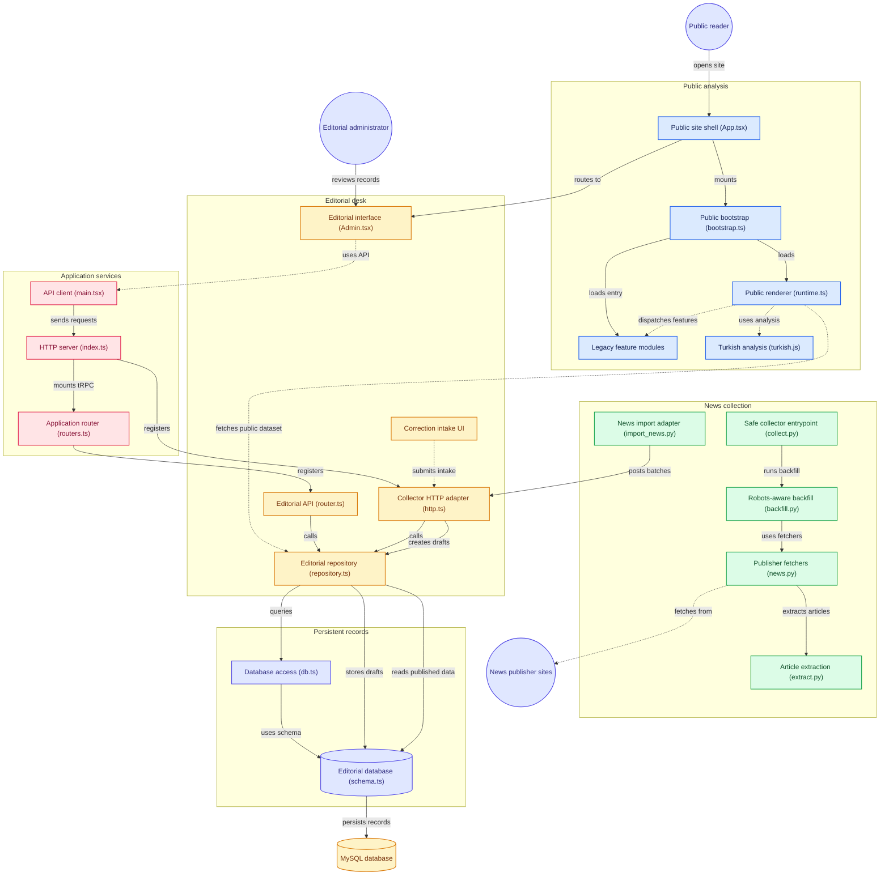

# Çapraz Manşet

## Architecture



Source: [public interface](client/src/public), [editorial desk](server/editorial), [collector](scraper), [application services](server/_core), and [database schema](drizzle/schema.ts).

Repository: [aylinunel/caprazmanset-oct26](https://github.com/aylinunel/caprazmanset-oct26). GitHub reports this repository as **public** as of the engineering review on 2026-10-27. Repository visibility does not deploy the application or provision its database and authentication.

Source-preserving refactor of the supplied Çapraz Manşet 3.0 HTML, with a protected Turkish editorial desk and the owner's existing [Turkish News Scraper](https://github.com/aylinunel/turkish-news-scraper) integrated at `296b50e661bd268840be7996a53a1ab7d2f935fd`.

The public site retains the supplied event comparisons, source profiles, spectrum/atlas, framing and headline-rule analysis, historical findings, methodology, search, and personal reading views. The monolithic artifact is now divided into feature modules, assets, a pure analysis layer, server-side editorial records and a separate collector. The public renderer intentionally remains a transitional imperative runtime to preserve its extensive existing behavior; this is not a claim that all legacy design debt has disappeared.

## Data and editorial boundaries

The owner-provided historical snapshot contains 15,913 embedded headlines, 1,489 events and 29 source profiles. Its metadata separately reports 105,869 harvested items and 75,849 political items; those are not the number of headlines displayed. The collector registry contains 53 publishers, not a guarantee that every publisher is accessible.

Historical political placements, ownership notes, bias examples, URLs and precomputed analyses are labelled **provided**, not independently verified. The 0–100 scale is preserved: 0 extreme left, 50 centre, 100 extreme right. Coordinates and coverage gaps do not prove publisher motive or party representation. New scraped records are drafts and are never automatically scored or published. Historical analyses are not regenerated when new articles are imported.

The public compatibility dataset is assembled from the same persistent MySQL records used by `/yonetim`. Drafts and archived records are excluded server-side. Editing a published record makes a new draft and saves its previous version. Publishing is a separate authenticated administrator action requiring evidence, provenance, method, public disclosure and an explicit rationale. Original historical migration is a documented owner-approved `provided` snapshot exception; subsequent article/analysis publication requires verification or an explicit demo label.

## Run the website

Use Node.js 22+, Corepack, pnpm **10.18.0**, and a MySQL-compatible database. Manus-managed development supplies database and authentication configuration. For another environment, configure the variables in `.env.example`; the OAuth implementation is Manus-specific and requires an authorized project. The GitHub repository alone does not provision authentication or a database.

```bash
corepack enable
pnpm install --frozen-lockfile
cp .env.example .env   # local configuration only; do not commit secrets
pnpm db:migrate
pnpm import:historical
pnpm dev
```

The application serves port `3000` by default and honors `PORT`. Open `/` for public pages and `/yonetim` for the protected editorial desk. Existing `#/yonetim` links redirect to that protected route. There are no simulated administrator accounts or development authentication bypasses. The project owner is assigned the admin role through validated Manus identity; other logged-in accounts require a deliberate authorized role assignment.

The historical import is transactional and idempotent. It records a content hash and refuses to overwrite an existing import with a different snapshot. It preserves subsequent editorial edits. Do not rerun `db:push` casually against an existing production schema; checked-in migrations are the deployment path. Development and publication share the managed database.

## Collect and review Turkish news

Use Python 3.11+ and a virtual environment:

```bash
python3 -m venv .venv
. .venv/bin/activate
python -m pip install -r scraper/upstream/requirements.lock
python scraper/collect.py --only birgun --output work/news.jsonl --db work/news.sqlite3 --status work/status.json
python scraper/import_news.py --input work/news.jsonl --endpoint https://YOUR_SITE --run-id collection_001 --dry-run
```

The safe entrypoint uses the upstream robots-aware backfill implementation for one Türkiye calendar day and exactly one explicitly selected publisher per run, with bounded pages, sitemap count, timeout, concurrency and request spacing. The upstream live poller does not enforce robots rules and is **not** the default integration entrypoint. Neither command is an archive-completeness guarantee or access-control bypass. Full extracted bodies may stay in the local upstream SQLite file when collection is intentionally run; the integration does not send bodies to the website.

In the **Türkçe scraper** tab of `/yonetim`, generate a 30-day import-only token. Store it in the process environment, not in a file, command-line argument, logs or source code. For example, read it without echo in Bash:

```bash
read -rs -p 'Import token: ' CAPRAZ_IMPORT_TOKEN; echo
export CAPRAZ_IMPORT_TOKEN
python scraper/import_news.py --input work/news.jsonl --endpoint https://YOUR_SITE --run-id collection_001
unset CAPRAZ_IMPORT_TOKEN
```

The adapter sends bounded batches to `POST /api/collector/import`. Tokens are hashed server-side and can be revoked. Publisher host/name validation and unique source+URL hashes protect attribution and deduplication. An administrator must then verify each draft and explicitly publish it. Unknown or unpublished source profiles must be reviewed first. There is no automatic event clustering of new imports, polling service, schedule or GitHub Actions collection job.

See [scraper integration](docs/scraper-integration.md) for the exact contract, upstream provenance, offline tests and failure behavior.

## Checks and reproducible source extraction

```bash
pnpm check
pnpm test
pnpm build
python -m unittest -v scraper/tests/test_import_news.py
python -m unittest -v scraper/tests/test_collect.py
python -m unittest discover -s scraper/upstream -p 'test_*.py' -v
```

The extractor `scripts/extract-public.mjs` reads the owner-supplied original HTML and reproduces the historical JSON, original SVG assets, analysis module and feature modules. See [public migration](docs/public-migration.md) for its arguments and behavior-preservation tests. The original uploaded HTML is not required to run the repository; extracted source/data are committed. The server import takes `data/original-dataset.json` as its default input.

The `Engineering checks` GitHub Actions workflow runs the application check, tests and build with Node.js 22 and pnpm 10.18.0, plus the offline Python integration and upstream suites, on pull requests and pushes to `main`. It does not publish packages, collect news, deploy, or access the managed database.

The full compatibility dataset is still downloaded and indexed client-side for feature parity. The server caches its assembled view briefly and invalidates it after editorial changes. The response is serialized and compressed once per distinct content (Brotli or gzip) and carries a content-hash `ETag` with `Cache-Control: no-cache`, so a returning browser revalidates and gets `304` when nothing was published; the page shell starts the dataset request in parallel with the renderer chunk (ADR-0001). This remains the principal performance limit; replacing legacy views with paginated endpoint-driven components is a future migration rather than an unreported completed feature.

## Private reader feedback

Correction buttons submit a private feedback intake with a stable public record target, claim, explanation, optional evidence URL, consent and receipt ID. They do not collect contact fields or keep requester data in browser storage. Submissions never change the challenged record automatically. Administrators can triage or close intakes with logged reasons; material content changes use the ordinary versioned publication workflow.

This is a basic private intake/manual-review queue, **not** a full independent appeals adjudication or public correction-notice system. No response SLA is promised. Intakes may contain personal information if a requester writes it into free text; administrators should not copy it into public records. The initial retention policy is manual quarterly review and removal/anonymization of closed intake narratives after 90 days through an authorized maintenance process; no unattended deletion job is installed.

## Reviews, deployment and licenses

The [original code review](docs/original-code-review.md) records the source artifact's problems and strengths. The [release review](docs/release-review.md), [validation record](docs/validation.md) and architecture notes document the original handoff. The [Engineering Team review](docs/engineering-review-2026-10-27.md) records the subsequent fixes and current local checks. Earlier reviews remain dated records. GitHub Actions runs code checks; public deployment and continuous collection remain separate actions.

GitHub currently exposes this repository publicly; earlier handoff documents describe its intended private delivery. The upstream scraper at the recorded commit contains no LICENSE/COPYING/NOTICE file; no upstream license has been invented. Supplied content and branding remain the owner's material. Public visibility does not grant redistribution permission. Resolve applicable permissions before further redistribution. Dependency licenses retain their own terms.
[](https://gitdiagram.com/aylinunel/caprazmanset-oct26?utm_source=readme&utm_medium=badge)
